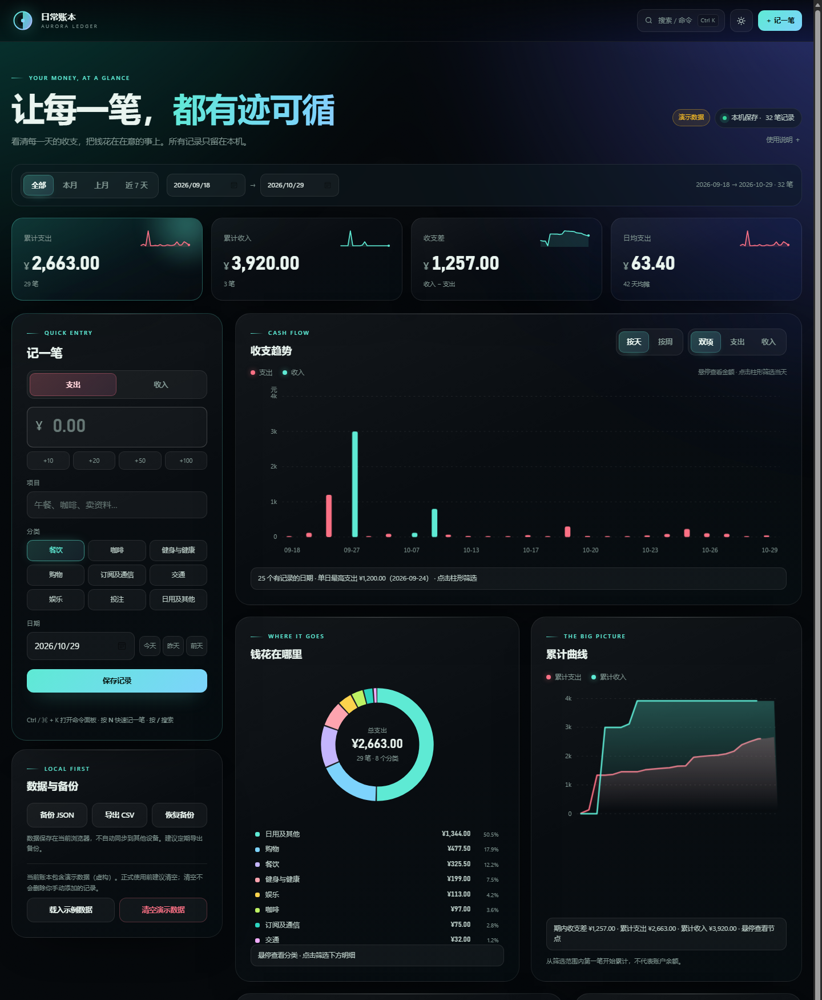

# 日常账本 · 极光版

一个**单文件、离线、数据只保存在本机**的个人记账工具。打开 `index.html` 即用，不需要安装、不需要联网、没有后端。



## 功能

- 收支记录、编辑、删除，删除后 7 秒内可撤销
- 日 / 周收支趋势、分类环形图、累计收支曲线
- 消费日历热力图，点击某天直接筛选
- 月度复盘、收入来源、最大支出排行
- 分类预算信封、预算圆环、50 / 30 / 20 参考
- 搜索、分类筛选、金额 / 日期排序、分页加载
- 深色极光主题 / 浅色主题一键切换
- `Ctrl / ⌘ + K` 命令面板；`N` 记一笔；`/` 搜索
- JSON 备份、CSV 导出、JSON 恢复
- 手机 / 平板响应式布局

## 快速开始

1. 解压压缩包。
2. 双击 `index.html`，推荐用 Edge / Chrome 打开。
3. 首次打开会载入一套**虚构的演示数据**，方便直接看到图表效果。
4. 正式使用前，在左侧「数据与备份」里点 **清空演示数据**，就可以从第一笔开始记。
5. 所有记录只保存在当前浏览器；换设备或清除浏览器数据前，请先导出 JSON 备份。

## 演示数据

- 共 32 笔虚构记录，日期相对打开当天生成，所以图表和日历总有内容。
- 每条演示记录都带 `demo: true` 标记，顶部会显示「演示数据」徽标。
- 「清空演示数据」只删除演示记录，**不会删除你手动添加的记录**。
- 清空后会出现「这是你的第一本账」引导，可以「记第一笔」或「载入示例数据」。
- 编辑任意演示记录后，它会转为你自己的记录，不会被「清空演示数据」删掉。

## 数据与隐私

- 数据保存在浏览器 `localStorage`，键名：`aurora-ledger-v1`。
- 没有服务器、没有账号、没有统计脚本，也不加载外部字体或图片。
- 清除浏览器站点数据、换浏览器或换设备会丢失记录。
- 建议定期在「数据与备份」导出 JSON；导入时会做格式校验。
- 本工具仅用于个人记账参考，不构成财务建议。

## 发布

这是一个纯静态单文件应用，发布方式很灵活：

- **最简方式**：只分享 `index.html`，对方双击即可使用。
- **压缩包**：分享整个目录（含 README、LICENSE、图标），适合发给朋友或存档。
- **静态托管**：把 `index.html` 上传到 GitHub Pages / Netlify / Cloudflare Pages / 任意静态服务器即可，无需构建步骤。数据保存在每个访问者自己的浏览器中。
- **桌面图标**：`assets/icon.ico` 是配套的多尺寸图标，可用来创建 Windows 快捷方式。

## 自定义

- 改存储键：`const KEY = 'aurora-ledger-v1';`
- 改演示数据：`DEMO_ROWS`（`buildDemoEntries()` 会把它转成记录）
- 改主题色：`html[data-theme="dark"]` / `html[data-theme="light"]` 中的 CSS 变量
- 改品牌名：搜索「日常账本」「AURORA LEDGER」替换即可

## 浏览器

- Edge / Chrome / Firefox 现代版本
- 需要支持 `localStorage`、SVG、CSS `backdrop-filter`；不支持时背景会退化为纯色，功能不受影响
- 在 `file://` 下直接打开也能正常保存数据

## 目录

```
日常账本-v1.0.0/
├── index.html          # 单文件应用
├── README.md
├── LICENSE
├── CHANGELOG.md
├── 使用说明.txt
├── screenshots/
│   └── desktop.png
└── assets/
    ├── icon.ico        # 多尺寸 Windows 图标
    └── icon-256.png
```

## 版本

v1.0.0 · 2026-10-29

## 许可

MIT License，详见 [LICENSE](LICENSE)。
